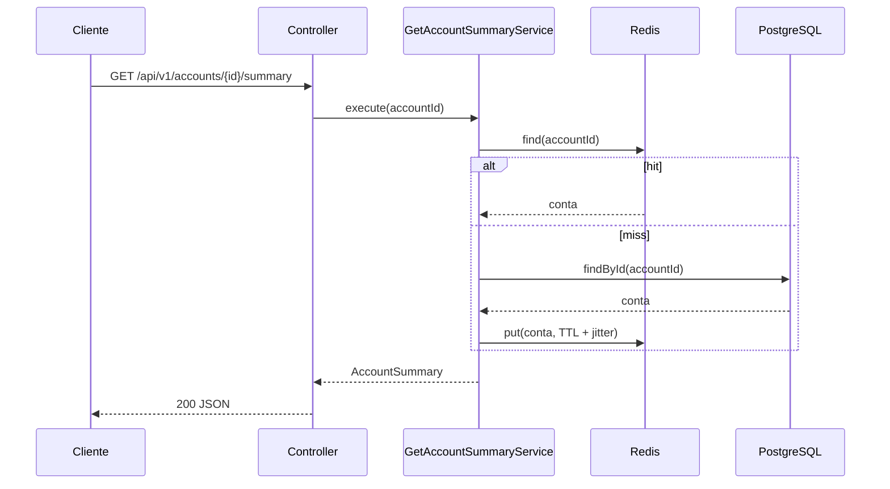
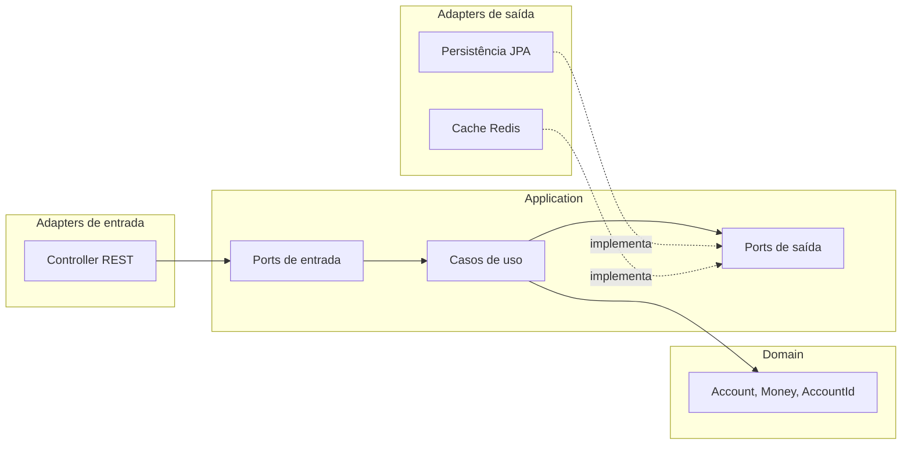

# distributed-cache

Serviço de consulta de saldo e limite de contas com cache distribuído em Redis, usando o padrão **Cache-Aside**, com resiliência, métricas e arquitetura hexagonal.


## Sobre

Consultas de saldo e limite são frequentes e quase sempre repetidas. Este serviço reduz a latência e a carga no banco de dados colocando um cache distribuído na frente da fonte da verdade (PostgreSQL), sem abrir mão de disponibilidade: se o Redis cair, a API continua respondendo.

O foco do projeto é mostrar engenharia de backend além do CRUD: arquitetura limpa verificada por testes, resiliência, proteção contra *cache stampede*, observabilidade e testes de integração com contêineres reais.

## Como funciona



## Arquitetura

Arquitetura hexagonal (ports & adapters). As dependências só apontam para dentro, e o ArchUnit garante isso no build.



Composição das portas de saída (de fora para dentro):

```
AccountCache:      FailSafeAccountCache -> InstrumentedAccountCache -> RedisAccountCache
AccountRepository: SingleFlightAccountRepository -> InstrumentedAccountRepository -> AccountPersistenceAdapter
```

As decisões de design estão registradas em [docs/decisoes-de-arquitetura.md](docs/decisoes-de-arquitetura.md).

### Destaques técnicos

| Tema | Solução |
|---|---|
| Cache-Aside | Orquestrado no caso de uso, com o Redis atrás de uma porta |
| Resiliência | Fallback para o banco, circuit breaker próprio e testado com relógio injetável |
| Stampede | Single-flight: requisições simultâneas para a mesma conta compartilham uma consulta ao banco |
| Expiração | TTL configurável com jitter para evitar expiração em massa |
| Invalidação | Endpoint explícito que nunca falha em silêncio (`503` se o Redis estiver fora) |
| Dinheiro | Value object com duas casas decimais, sem arredondamento silencioso |
| Erros da API | RFC 9457 (`application/problem+json`) |
| Observabilidade | Métricas Micrometer de cache, circuito e banco |
| Schema | Migrations versionadas com Flyway |

## Stack

- Java 21
- Spring Boot 4.0.8 (Web MVC, Data JPA, Data Redis, Actuator)
- PostgreSQL 17 e Flyway
- Redis 7.4
- Micrometer
- JUnit 5, AssertJ, Mockito, Testcontainers e ArchUnit
- Docker e Docker Compose
- GitHub Actions

## Como executar

Pré-requisitos: JDK 21 e Docker (com `docker-compose` 1.28 ou superior, ou `docker compose`).

### Tudo em contêineres

```bash
docker-compose --profile app up -d --build
curl http://localhost:8080/api/v1/accounts/22222222-2222-2222-2222-222222222222/summary
```

Para derrubar:

```bash
docker-compose --profile app down
```

### Só as dependências, com a aplicação na IDE ou no terminal

```bash
docker-compose up -d
./mvnw spring-boot:run -Dspring-boot.run.profiles=local
```

O profile `local` carrega três contas de exemplo:

| Conta | Saldo | Limite | Situação |
|---|---|---|---|
| `11111111-1111-1111-1111-111111111111` | 1500.00 | 2000.00 | Saldo positivo |
| `22222222-2222-2222-2222-222222222222` | -350.75 | 1000.00 | Usando o limite |
| `33333333-3333-3333-3333-333333333333` | -1200.00 | 1000.00 | Acima do limite |

## API

### `GET /api/v1/accounts/{accountId}/summary`

Retorna saldo, limite contratado, limite utilizado, limite disponível e total disponível.

```json
{
  "accountId": "22222222-2222-2222-2222-222222222222",
  "balance": -350.75,
  "creditLimit": 1000.00,
  "usedLimit": 350.75,
  "availableLimit": 649.25,
  "availableFunds": 649.25,
  "updatedAt": "2026-10-16T09:00:00Z"
}
```

| Status | Situação |
|---|---|
| 200 | Conta encontrada |
| 400 | `accountId` não é um UUID válido |
| 404 | Conta não encontrada |
| 500 | Erro inesperado |

### `DELETE /api/v1/accounts/{accountId}/cache`

Remove a entrada da conta do cache. A próxima consulta busca o dado atualizado no banco.

| Status | Situação |
|---|---|
| 204 | Entrada removida (ou inexistente) |
| 400 | `accountId` não é um UUID válido |
| 503 | Redis indisponível: a invalidação não pôde ser feita |

Este endpoint ainda não tem autenticação e deve ficar restrito à rede interna.

## Configuração

| Propriedade | Variável | Padrão | Descrição |
|---|---|---|---|
| `spring.datasource.url` | `DB_URL` | `jdbc:postgresql://localhost:5432/distributed_cache` | URL do PostgreSQL |
| `spring.datasource.username` | `DB_USER` | `dcache` | Usuário do banco |
| `spring.datasource.password` | `DB_PASSWORD` | `dcache` | Senha do banco |
| `spring.data.redis.host` | `REDIS_HOST` | `localhost` | Host do Redis |
| `spring.data.redis.port` | `REDIS_PORT` | `6379` | Porta do Redis |
| `server.port` | `SERVER_PORT` | `8080` | Porta da aplicação |
| `dcache.cache.enabled` | — | `true` | Desativa o cache quando `false` |
| `dcache.cache.ttl` | — | `5m` | Tempo de vida de cada entrada |
| `dcache.cache.ttl-jitter` | — | `0.1` | Fração máxima somada ao TTL, de 0 a 1 |
| `dcache.cache.resilience.failure-threshold` | — | `3` | Falhas seguidas até o Redis ser ignorado |
| `dcache.cache.resilience.open-duration` | — | `30s` | Tempo em que o Redis fica ignorado antes de uma nova tentativa |

## Observabilidade

As métricas ficam em `/actuator/metrics` e, no formato Prometheus, em `/actuator/prometheus`.

| Métrica | Descrição |
|---|---|
| `dcache.cache.lookups` | Acertos (`hit`) e erros (`miss`) nas leituras do cache |
| `dcache.cache.operations` | Latência e resultado (`success`/`error`) das operações no Redis |
| `dcache.cache.circuit.open` | `1` quando o circuit breaker do cache está aberto |
| `dcache.repository.lookups` | Consultas ao PostgreSQL por resultado |

Taxa de acerto do cache (PromQL):

```
sum(rate(dcache_cache_lookups_total{result="hit"}[5m])) / sum(rate(dcache_cache_lookups_total[5m]))
```

## Testes

```bash
./mvnw verify
```

Os testes de integração sobem PostgreSQL e Redis reais com Testcontainers, então o Docker precisa estar em execução.

| Tipo | O que cobre |
|---|---|
| Unitários | Domínio, casos de uso (com fakes), mappers, políticas de TTL e circuit breaker |
| Slice (`@WebMvcTest`) | Controller, contratos HTTP e tratamento de erros |
| Integração | Persistência, Redis, fluxo Cache-Aside ponta a ponta, invalidação e métricas |
| Resiliência | API continua respondendo com o Redis indisponível |
| Concorrência | Single-flight com várias threads, sem `sleep` fixo |
| Arquitetura | Regras de dependência entre camadas com ArchUnit |

## Estrutura

```
br.com.nevvesdev.dcache
├── domain
│   ├── exception
│   ├── model
│   └── shared
├── application
│   ├── exception
│   ├── port
│   │   ├── in
│   │   └── out
│   └── service
├── adapter
│   ├── in/web
│   └── out
│       ├── cache
│       └── persistence
└── infrastructure
    ├── config
    └── observability
```

## CI

O pipeline roda em cada push e pull request:

1. Build e todos os testes (`./mvnw verify`).
2. Build da imagem Docker, subida da aplicação com as dependências e teste de fumaça (consulta real à API e às métricas).

## Próximos passos

- Autenticação e autorização para o endpoint de invalidação
- Invalidação orientada a eventos (mensageria) quando a fonte da verdade for atualizada
- Testes de carga para medir ganho de latência e comportamento sob concorrência

## Licença

Distribuído sob a licença MIT. Veja o arquivo [LICENSE](LICENSE).
